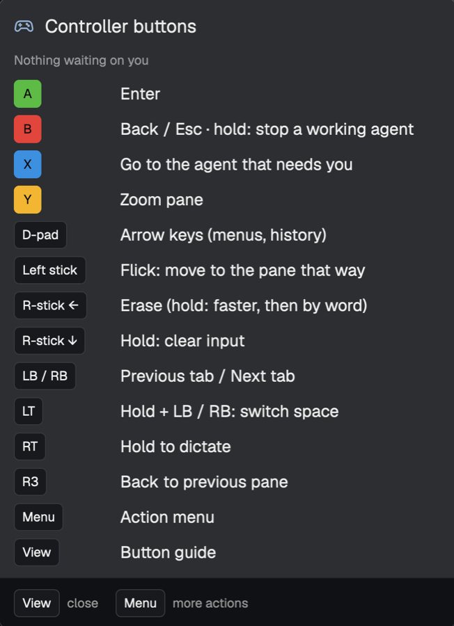

# herdr-pad

Drive the [Herdr](https://herdr.dev) desktop app with an Xbox controller: hop between agents,
answer their prompts, move between panes, tabs and spaces, all from the couch.

A small floating panel in Herdr shows what each press did, where X will take you next, the
action menu and a button guide. There's no rumble on macOS, so the panel is your feedback.

<p align="center"></p>

## Install

```sh
cargo build --release
./target/release/herdr-pad install
```

`install` copies the binary to `~/.local/bin/herdr-pad`, puts the `controller` mod in
`~/.config/herdr-app/mods/`, writes `~/.config/herdr-pad/config.toml`, and starts a login item
(`~/Library/LaunchAgents/dev.herdr-pad.plist`) so it runs at every login.

`herdr-pad uninstall` stops it and removes the login item and the mod (your config stays).

## Buttons

| Button | Does |
|---|---|
| A | Enter. Ignored for 250 ms right after the controller jumps you somewhere, so you see a prompt before you can answer it |
| B | Closes a dialog, else Esc. **Hold** it to interrupt an agent that's working: a reflex tap won't stop it |
| X | The agent that needs you: blocked ones first, then finished ones. Press again for the next |
| Y | Zoom the pane (again: unzoom) |
| D-pad | Arrow keys: menus in agent prompts, shell history. Repeats when held |
| Left stick | Flick toward a pane to move there |
| LB / RB | Previous / next tab |
| Hold LT + LB / RB | Previous / next space (the space list shows while LT is held) |
| RT (hold) | Dictation, push to talk: holds Fn, Wispr Flow's default push-to-talk key (`[dictation]` to change). Needs Accessibility permission for herdr-pad |
| R3 | Back to the pane you were on before the last jump (again: bounce back) |
| Right stick ← | Erase: one character per flick; held, it repeats, then deletes word by word |
| Hold right stick ↓ | Clear the whole input (Claude Code's box or a shell line). In Claude Code, Ctrl+Y brings it back |
| Menu | Action menu: new Claude or shell tab, **New space…** (pick a folder: A starts Claude there, Y a shell; recent spaces and `~/Projects` listed), splits, next/previous agent, Ctrl+C and Close pane (those two need A held) |
| View | Button guide. Tap: stays open. Hold: shows while held |

The only two-button action is LT + bumpers, which works like Shift: bumpers move between
tabs, and with LT held they move one level up, between spaces.

The controller is ignored while another app is in front, so a game won't drive Herdr
(`only_when_focused` in the config).

## Configure

Everything above is `~/.config/herdr-pad/config.toml`; save it and the change applies within a
second (a broken file keeps the last good one and logs why). The file documents every action:
`keys:`, `cmd:` (any `herdr-app commands` command), and the built-ins. Delete it for the defaults.

## Check things

```sh
herdr-pad test [--raw]              # prints each button as you press it (--raw: every change)
herdr-pad sim menu dpad_down a      # press buttons without a controller
herdr-pad sim b:600                 # hold B for 600 ms
tail -f ~/Library/Logs/herdr-pad.log
cargo test                          # engine rules, with a fake Herdr
```

## How it works

- `herdr-pad` reads the controller with Apple's GameController framework (with background
  monitoring on, so it works while Herdr is in front). Raw HID libraries like gilrs see an
  Xbox controller connect but get no input on macOS, because Apple's driver owns it. It acts through
  Herdr's own CLIs: `herdr-app do <command>` for the window and `hc keys` to press keys in the
  focused terminal (each call is a few ms).
- It sends the panel's view to the mod as `herdr-app do 'controller.state <json>'`; the mod
  (`mod/main.js`) only draws it, opened as a `window` overlay that never takes the keyboard.
- Herdr mods can't run long-lived programs (`exec` has a 30 s limit), so the controller loop
  lives in the login item, not in the mod.

## Requirements

macOS (it uses Apple's GameController framework), the Herdr desktop app with its `herdr-app` and
`hc` CLIs, Rust 1.85+, and an Xbox controller (others that macOS supports as a gamepad should work).

## License

MIT
